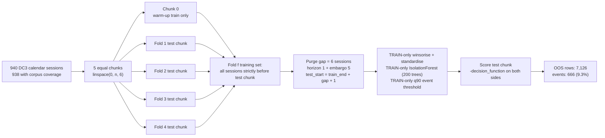

# Figure 3.1 — Anchored purged walk-forward (schematic)

**Status:** handoff scaffold, not a result figure. Redrawn from the frozen
`docs/analysis_plan.md` §4; the student renders the final figure. Event count
updated to the corrected v2.1.0 sample (666 events; EXP-0015).

**Slots.**
- Figure 3.1 = this schematic (student redraws in the thesis tool).
- Table 3.1 = fold boundaries / train-test counts (from `outputs/tables/hypothesis_grid_results_v2.csv` and the fold diagnostics table).
- Table 3.2 = feature dictionary (`ch3_feature_dictionary.csv`).

**Citation keys.** EXP-0004a (scoring), EXP-0011a (effective N), EXP-0013 (freeze).
