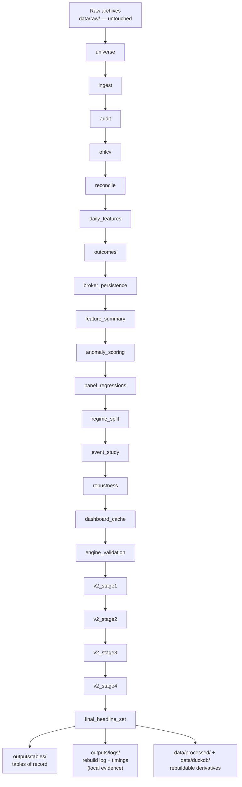

# Figure 4.1 — Clean-rebuild pipeline (schematic)

**Status:** handoff scaffold, not a result figure. Step order is the ordered
`STEPS` list in `scripts/run_stage6_rebuild.py`; the student redraws it.

**Slots.**
- Figure 4.1 = this pipeline schematic (student redraws).
- Table 4.1 = corpus audit summary (`corpus_*` tables; `notebooks/01_data_quality_audit.ipynb`).
- Table 4.2 = volume reconciliation summary (`outputs/tables/volume_reconciliation.csv`).
- Table 4.3 = clean-rebuild drift audit (`outputs/tables/v2_clean_rebuild_audit.csv`).

**Citation keys.** EXP-0002b/c/e/f (corpus + reconciliation), EXP-0013 (clean
rebuild + freeze). Raw archives are provenance anchors and are never deleted by
the driver.
